# Coffee Shop

[](https://github.com/hendisantika/coffeeshop/actions/workflows/maven.yml)

A comprehensive Spring Boot application for coffee shop management with a modern Thymeleaf UI, REST API, and MongoDB
backend supporting full CRUD operations for stores, products, categories, and orders.

## Features

- **Modern Web UI** - Bootstrap 5-based responsive UI with Thymeleaf templates
- **Complete CRUD Operations** - Full Create, Read, Update, Delete for all entities
- **Product Management** - Manage coffee shop menu items with categories and pricing
- **Order Management** - Create and track customer orders with status updates
- **Store Management** - Manage store locations with geospatial support
- **Dashboard** - Real-time statistics and recent orders overview
- **REST API** - Exposes data via Spring Data REST with HATEOAS support
- **MongoDB Integration** - Uses Spring Data MongoDB for data persistence
- **Docker Compose Integration** - Automatic MongoDB container lifecycle management
- **Geospatial Indexing** - Supports location-based queries with 2DSphere indexing
- **Sample Data** - Auto-loads sample stores, categories, and products on startup
- **HAL Explorer** - Built-in API browser for exploring REST endpoints

## Tech Stack

- Java 25
- Spring Boot 4.1.0
- Spring Data MongoDB
- Spring Data REST
- Spring Boot Docker Compose (automatic container management)
- Spring Batch 6 (CSV import of sample stores)
- Thymeleaf
- Bootstrap 5.3
- jQuery
- Lombok
- MongoDB 7.0
- Testcontainers 2 (for testing)

## Prerequisites

- JDK 25 or higher
- Maven 3.9+ (or use the bundled Maven Wrapper `./mvnw`, which downloads Maven 3.9.11)
- Docker (for running MongoDB)

## Getting Started

### Quick Start (Recommended)

The application uses **Spring Boot Docker Compose** integration, which automatically manages MongoDB container
lifecycle.

**Just run:**

```bash
./mvnw spring-boot:run
```

That's it! Spring Boot will automatically:

1. Detect the `compose.yaml` file
2. Start the MongoDB container
3. Wait for MongoDB to be healthy
4. Connect to the database
5. Initialize sample data

The application will be available at `http://localhost:8080`

When you stop the application, MongoDB container is automatically stopped as well.

### Manual Setup (Alternative)

If you prefer to manage MongoDB manually:

1. **Disable Docker Compose integration** in `application.properties`:
   ```properties
   spring.docker.compose.enabled=false
   ```

2. **Start MongoDB manually:**
   ```bash
   docker run -d --name coffeeshop-mongo -p 27017:27017 mongo:7.0
   ```

3. **Run the application:**
   ```bash
   ./mvnw spring-boot:run
   ```

### Building for Deployment

```bash
./mvnw clean package -DskipTests
java -jar target/coffeeshop-0.0.1-SNAPSHOT.jar
```

> **Note:** Spring Boot excludes the Docker Compose integration from the packaged JAR, so MongoDB must already be
> running (e.g. `docker compose up -d`) before starting the application with `java -jar`.

## Web UI

Access the web interface at `http://localhost:8080`

### Available Pages

- **Dashboard** (`/`) - Overview with statistics and recent orders
- **Stores** (`/ui/stores`) - List, add, view, and delete store locations
- **Categories** (`/ui/categories`) - Manage product categories
- **Products** (`/ui/products`) - Full CRUD for menu items with filtering
- **Orders** (`/ui/orders`) - Create orders, update status, view details

### Screenshots

#### Dashboard

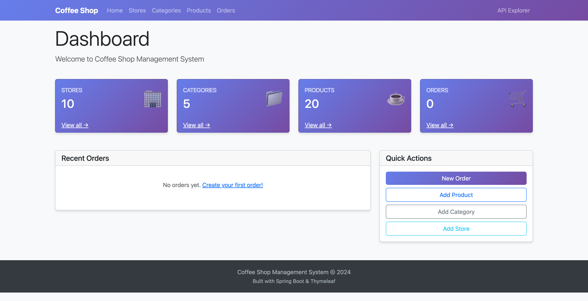

#### Store Management

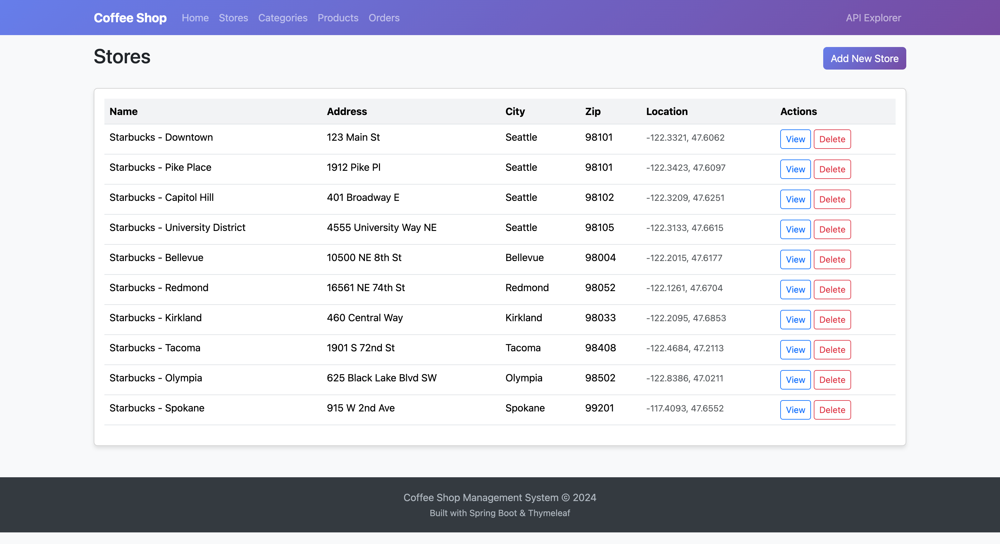
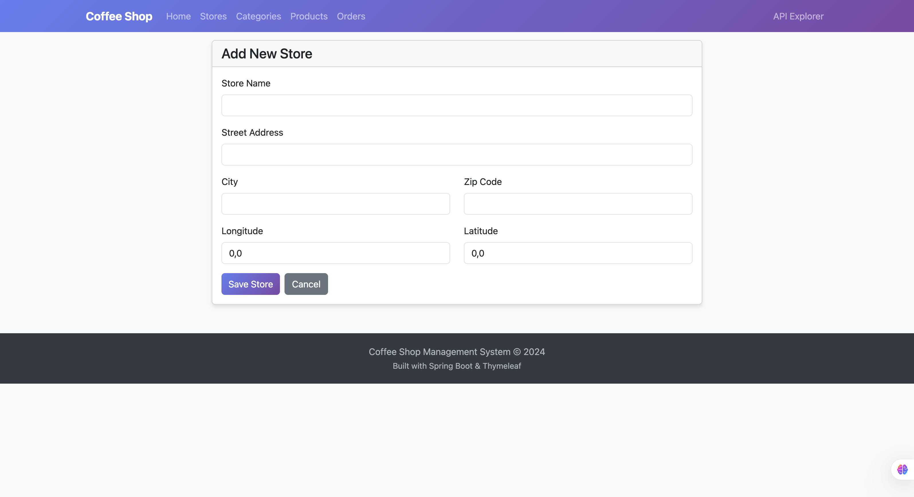

#### Category Management

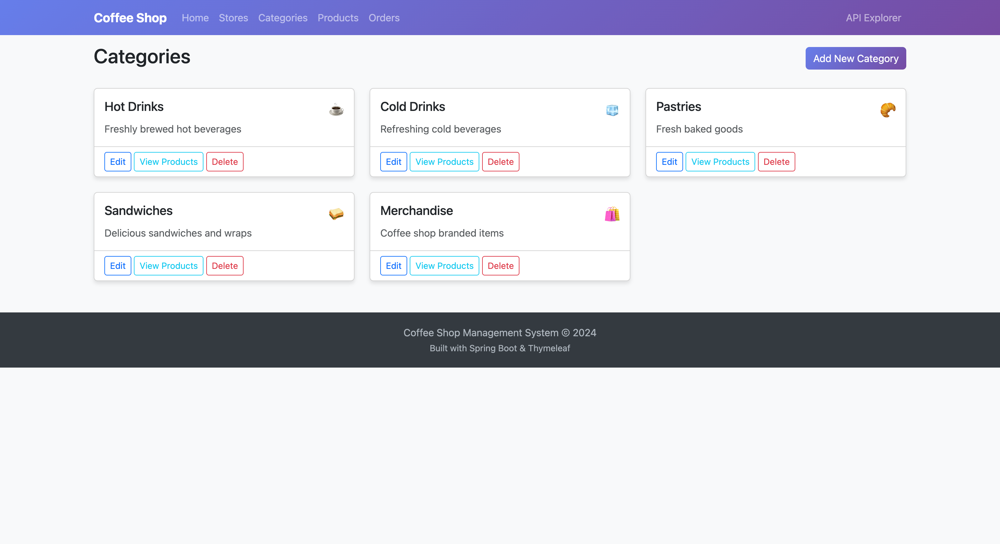
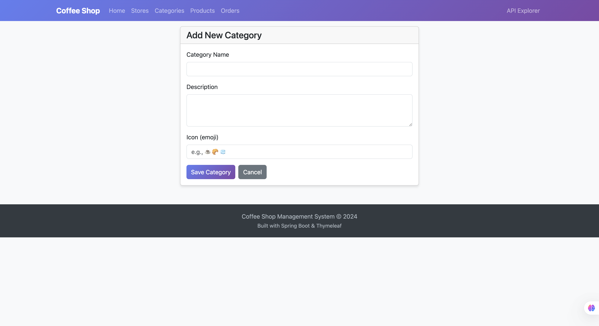

#### Product Management

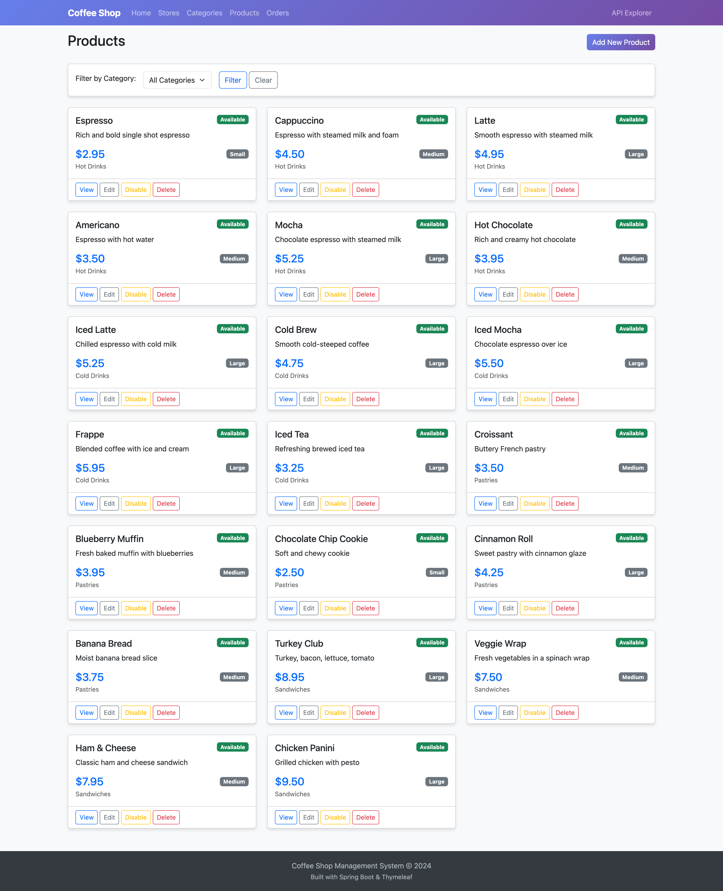
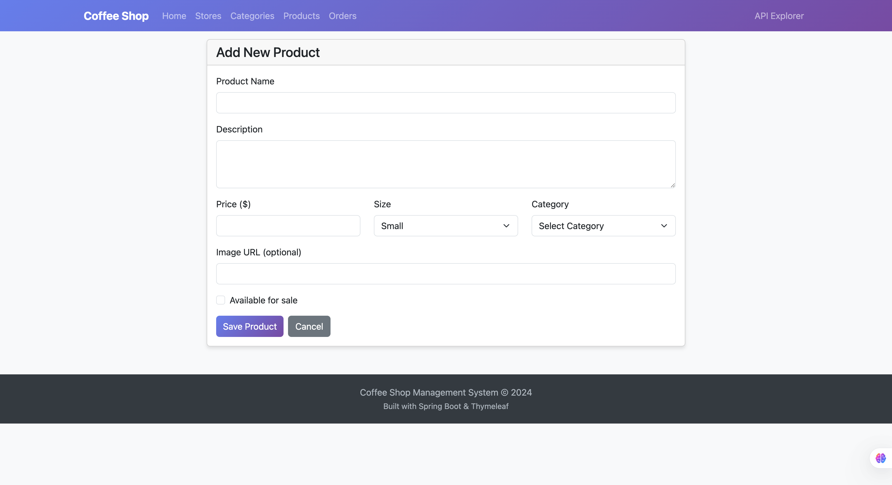
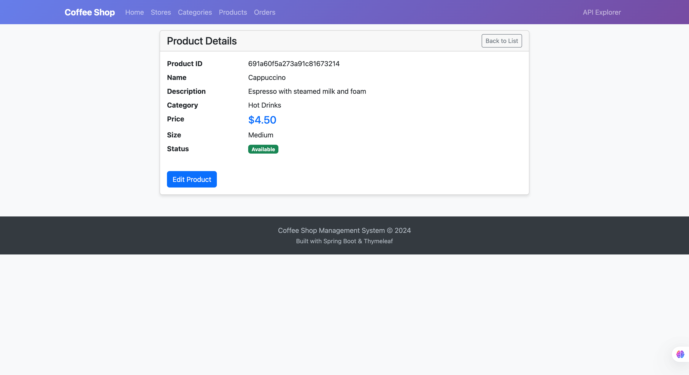

#### Order Management

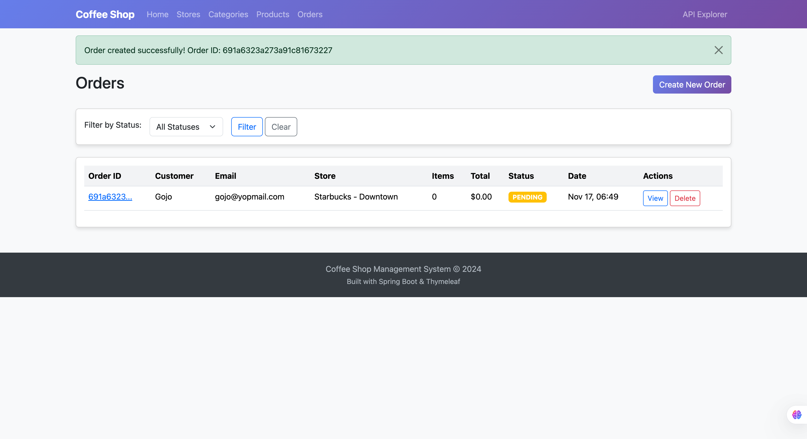
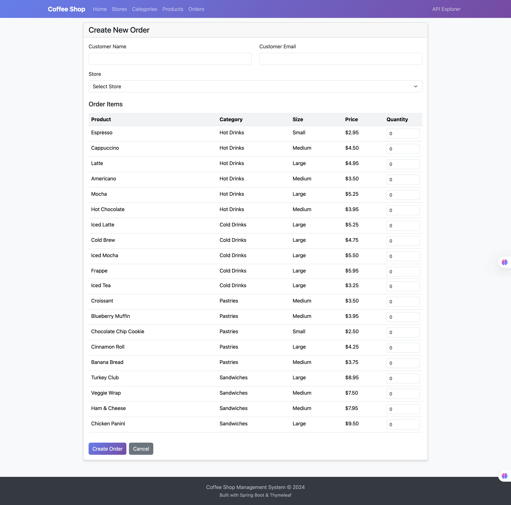
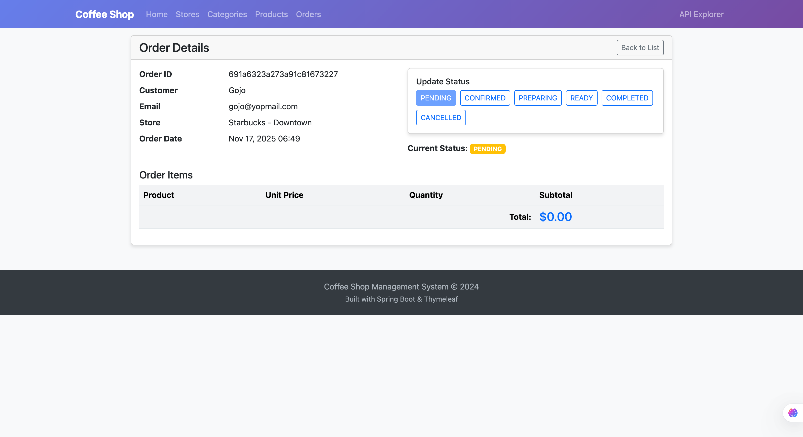
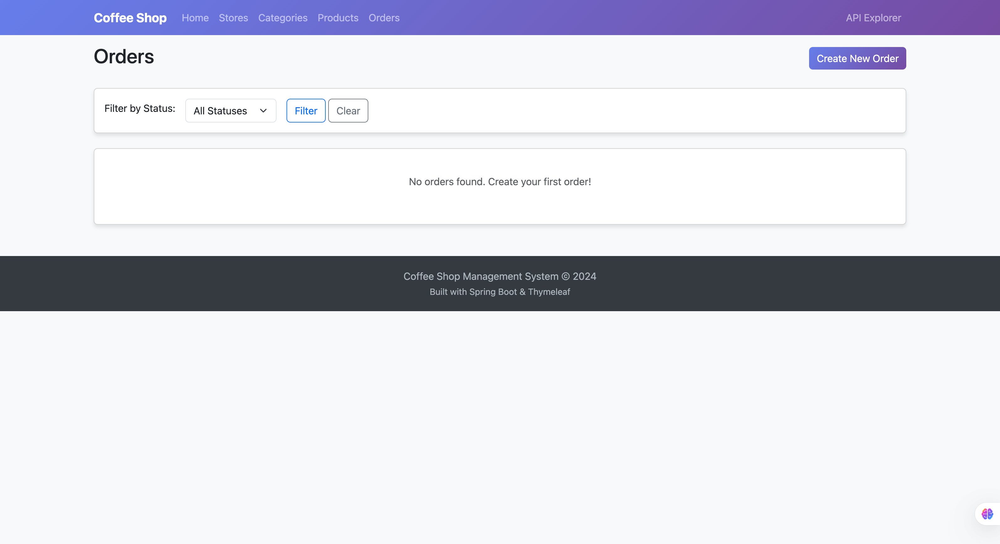

## REST API Endpoints

The REST API is available at `/api` prefix:

### Root Endpoint

```bash
curl http://localhost:8080/api
```

Returns:

```json
{
  "_links": {
    "stores": {
      "href": "http://localhost:8080/api/stores{?page,size,sort*}",
      "templated": true
    },
    "products": {
      "href": "http://localhost:8080/api/products{?page,size,sort*}",
      "templated": true
    },
    "categories": {
      "href": "http://localhost:8080/api/categories{?page,size,sort*}",
      "templated": true
    },
    "orders": {
      "href": "http://localhost:8080/api/orders{?page,size,sort*}",
      "templated": true
    },
    "profile": {
      "href": "http://localhost:8080/api/profile"
    }
  }
}
```

### List All Stores

```bash
curl http://localhost:8080/api/stores
```

### List All Products

```bash
curl http://localhost:8080/api/products
```

### List All Categories

```bash
curl http://localhost:8080/api/categories
```

### List All Orders

```bash
curl http://localhost:8080/api/orders
```

### Search Stores by Location (Geospatial Query)

```bash
curl "http://localhost:8080/api/stores/search/by-location?location={longitude},{latitude}&distance={distance}"
```

### Pagination

```bash
curl "http://localhost:8080/api/stores?page=0&size=5&sort=name,asc"
```

## HAL Explorer

Access the HAL Explorer at:

```
http://localhost:8080/api/explorer
```

This provides an interactive UI to explore and test the REST API.

## Project Structure

```
src/main/java/com/hendisantika/coffeshop/
├── CoffeshopApplication.java       # Main application entry point
├── StoreInitializer.java           # Loads store data from CSV
├── DataInitializer.java            # Initializes categories and products
├── controller/
│   ├── HomeController.java         # Dashboard controller
│   ├── StoreController.java        # Store CRUD operations
│   ├── CategoryController.java     # Category CRUD operations
│   ├── ProductController.java      # Product CRUD operations
│   └── OrderController.java        # Order management
├── entity/
│   ├── Store.java                  # Store with Address
│   ├── Category.java               # Product category
│   ├── Product.java                # Menu item
│   └── Order.java                  # Customer order with items
└── repository/
    ├── StoreRepository.java        # Store data access
    ├── CategoryRepository.java     # Category data access
    ├── ProductRepository.java      # Product data access
    └── OrderRepository.java        # Order data access

src/main/resources/
├── application.properties          # Application configuration
├── starbucks.csv                   # Sample store data
└── templates/
    ├── home.html                   # Dashboard page
    ├── fragments/layout.html       # Base template with navbar
    ├── stores/                     # Store templates
    ├── categories/                 # Category templates
    ├── products/                   # Product templates
    └── orders/                     # Order templates
```

## Sample Data

The application automatically initializes sample data on first startup:

- **10 Store Locations** - Sample Starbucks stores in the Pacific Northwest (Seattle, Bellevue, Redmond, etc.)
- **5 Categories** - Hot Drinks, Cold Drinks, Pastries, Sandwiches, Merchandise
- **20 Products** - Including espresso, lattes, pastries, sandwiches with realistic pricing

## Configuration

Current configuration in `application.properties`:

```properties
# MongoDB Configuration
spring.mongodb.database=coffeeshop
spring.mongodb.host=localhost
spring.mongodb.port=27017
spring.mongodb.representation.uuid=java-legacy

# Server Configuration
server.port=8080

# Thymeleaf Configuration
spring.thymeleaf.cache=false
spring.thymeleaf.check-template-location=true

# Spring Data REST Configuration
spring.data.rest.base-path=/api

# Docker Compose Configuration
spring.docker.compose.enabled=true
spring.docker.compose.lifecycle-management=start_and_stop
spring.docker.compose.start.command=up
spring.docker.compose.stop.command=down
spring.docker.compose.stop.timeout=PT1M
```

Key settings:

- MongoDB database: `coffeeshop`
- UUID representation: `java-legacy` (Spring Boot 4 no longer sets a default; required because `Store` uses `UUID` ids)
- REST API base path: `/api`
- Thymeleaf caching disabled for development
- Server port: `8080`
- Docker Compose auto-management enabled with start/stop lifecycle

## Running Tests

Tests require Docker to be running (uses TestContainers):

```bash
./mvnw test
```

## Building for Production

```bash
./mvnw clean package -DskipTests
```

The executable JAR will be created at `target/coffeeshop-0.0.1-SNAPSHOT.jar`

## Docker Compose

The project includes a `compose.yaml` file that is automatically managed by Spring Boot:

```yaml
services:
  mongodb:
    image: 'mongo:7.0'
    container_name: coffeeshop-mongodb
    environment:
      - 'MONGO_INITDB_DATABASE=coffeeshop'
    ports:
      - '27017:27017'
    volumes:
      - ./mongodb_data:/data/db
    healthcheck:
      test: [ "CMD", "mongosh", "--eval", "db.adminCommand('ping')" ]
      interval: 10s
      timeout: 5s
      retries: 5
      start_period: 10s

volumes:
  mongodb_data:
    driver: local
```

Features:

- **Automatic lifecycle management** - Container starts/stops with the application
- **Health checks** - Ensures MongoDB is ready before application connects
- **Persistent data** - Data is stored in `./mongodb_data` and preserved between restarts
- **No manual Docker commands needed** - Spring Boot handles everything

## Continuous Integration

GitHub Actions ([`.github/workflows/maven.yml`](.github/workflows/maven.yml)) builds and tests the project on every push
and pull request to `master` using Temurin JDK 25, then submits the Maven dependency graph for Dependabot alerts.

## License

This project is open source and available under the MIT License.

## Author

- Hendi Santika
- Email: hendisantika@gmail.com
- Telegram: @hendisantika34
